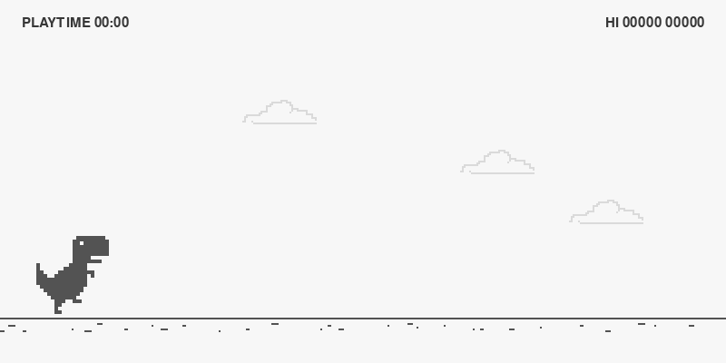

# SuperDino

So, I recreated the Chrome dinosaur game using Python/Pygame.



## Download

Install Python 3.10 or newer, download and extract the project ZIP, then open Command Prompt or PowerShell in the `SuperDino` folder and run:

```sh
python -m pip install -r requirements.txt
python main.py
```

# About SuperDino

I keep code in `core`, `ui`, `game`, and `audio`.

The player, score, obstacles, settings, theme, and hitboxes are frozen dataclasses, so an update makes a new value instead of changing the old one.

Physics steps are 1/120 second. I cap a frame at 0.1 seconds so a stalled frame doesn't make the simulation try to catch up too much; that's the reason noted in `config.py`.

During a theme fade, the track and cloud each have one cache slot. A new tint replaces the old cached surface instead of adding another entry.

The draw helpers in `ui/screens.py` take the surface, fonts, rectangles, theme, and other values they need. They don't take the window.

> **Note:** The code might not be that clean because I was about to add some features, then got lazy xD.

Like the classic Dino game, jump over obstacles and duck to avoid them. You can customize the controls in the settings.


The Dinosaur Chrome  game and its art are Google's. See [LICENSE](LICENSE).
